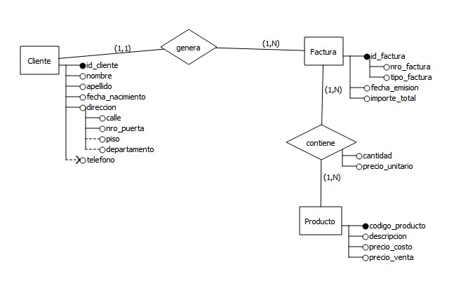
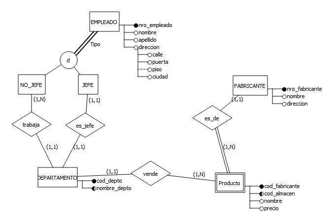
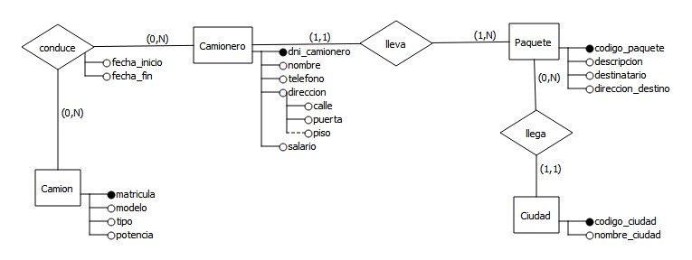
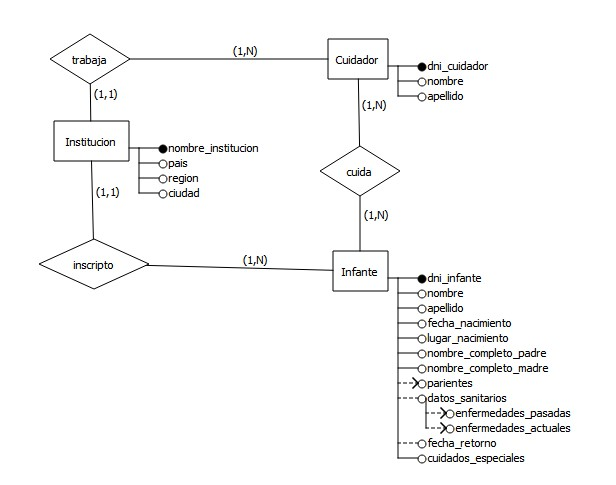
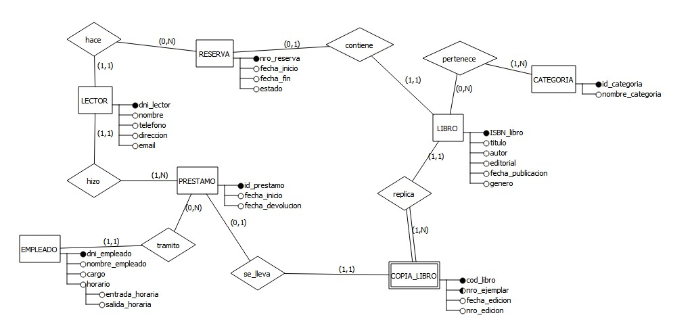
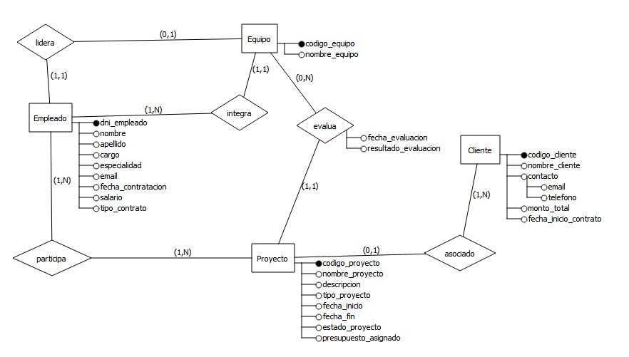

# Trabajos Prácticos: Modelado de Datos

Este repositorio recopila las soluciones y decisiones de diseño conceptual aplicadas a diferentes problemáticas de negocio, utilizando diagramas Entidad-Relación (DER)

  
<b>Guía de Lectura: Cardinalidades </b>

  
  *Para la correcta interpretación de los diseños, se utiliza la convención de __"mirar al frente"__*:

* **Lógica de lectura:** La cardinalidad que define a una entidad se encuentra anotada en el extremo opuesto de la relación.
  
* **Interpretación de los valores:**
    * **(0, N):** **Opcionalidad.** La entidad puede relacionarse con muchos ejemplares o ninguno.
    * **(1, 1):** **Obligatoriedad única.** La entidad debe relacionarse con exactamente un ejemplar.
    * **(1, N):** **Obligatoriedad múltiple.** La entidad debe relacionarse con al menos uno o varios ejemplares.

> **Ejemplo:** Si en la relación entre `Paquete` y `Ciudad`, el valor **(1,1)** está junto a `Ciudad`, significa que "El paquete llega a **una sola** ciudad".

---

## Ejercicio 1: Sistema de Facturación y Clientes

* **Reto:** Evitar que el precio histórico de venta de un producto se altere ante futuras modificaciones en el catálogo general.
* **Solución de Diseño:** Se modeló una relación muchos a muchos (M:N) entre `Factura` y `Producto`, incorporando los atributos `cantidad` y `precio_unitario` en la relación misma. Esto permite congelar el valor exacto al momento de la transacción de forma independiente al catálogo.

## Ejercicio 2: Gestión de Depósito y Departamentos

* **Reto:** Garantizar la exclusividad de líderes por departamento y resolver la identificación dependiente de los productos.
* **Solución de Diseño:** 
  * Se implementó una especialización disjunta `{d}` para separar a los empleados en `JEFE` y `NO_JEFE`, asegurando que un trabajador lidere un único sector.
  * El `Producto` se definió como entidad débil, construyendo su identificación completa mediante el número de fabricante y el código de almacén.
  * Se estableció una cardinalidad (1,1) desde el producto hacia la relación de venta para limitar su comercialización a un único departamento.
 
 

## Ejercicio 3: Sistema de Distribución de Paquetes

* **Reto:** Registrar el historial de conducción de camiones y asegurar la trazabilidad de los envíos.
* **Solución de Diseño:** 
  * Se estableció una relación con opcionalidad y atributos temporales (`fecha_inicio` y `fecha_fin`) entre `Camionero` y `Camión` para mantener el registro histórico de asignaciones.
  * Se vinculó `Paquete` con `Camionero` mediante una cardinalidad (1,1) para garantizar un único responsable asignado por envío.
  * Se configuró la relación con `Ciudad` para definir unívocamente la localidad de destino.
 
 

## Ejercicio 4: Sistema de Control de Niños Refugiados

* **Reto:** Gestionar contactos, historiales médicos y la ubicación institucional de menores bajo cuidado.
* **Solución de Diseño:** 
  * Se configuró una relación de obligatoriedad múltiple (1,N) con `Cuidador` para asignar múltiples responsables por infante.
  * Se utilizaron atributos multivaluados para datos sanitarios y filiatorios, evitando redundancias en la entidad principal.
  * Se vinculó cada niño a una única `Institución` mediante una relación (1,1) que contiene la jerarquía geográfica.
  * Se incorporó el atributo opcional `fecha_retorno` para registrar el reencuentro familiar en los casos que corresponda.
 
 

  ---

## Ejercicio 5: Sistema de Gestión de Biblioteca y Préstamos

* **Reto:** Diferenciar la obra bibliográfica del stock físico y asegurar la trazabilidad de los préstamos.
* **Solución de Diseño:** 
  * Se separó la entidad `LIBRO` de `COPIA_LIBRO`, modelando esta última como entidad débil dependiente del ISBN para gestionar inventario individual.
  * Se implementó una relación asociada entre `LECTOR`, `PRESTAMO` y `EMPLEADO` para auditar la operación.
  * Se añadió la entidad `RESERVA` con relaciones de opcionalidad (0,N) para gestionar la demanda sobre ejemplares no disponibles.
  * Se estableció una relación (M:N) con `CATEGORIA` para permitir la clasificación múltiple de las obras.

 
 
---

## Ejercicio 6: Gestión de Startup de Consultoría Tecnológica

* **Reto:** Modelar estructuras organizacionales complejas y la participación operativa en proyectos.
* **Solución de Diseño:** 
* Se separó la pertenencia administrativa a un `EQUIPO` de la participación operativa en múltiples `PROYECTO`s para registrar las distintas funciones de cada empleado.
*   * La relación de liderazgo se configuró como (0,1) en empleados, permitiendo personal a cargo o ninguno.
  * La vinculación con `CLIENTE` se estableció como opcional (0,1) para contemplar tanto desarrollos externos como productos propios.
  * Se definieron evaluaciones de fase con opcionalidad (0,N) para permitir un registro incremental conforme avanza el desarrollo.

 
